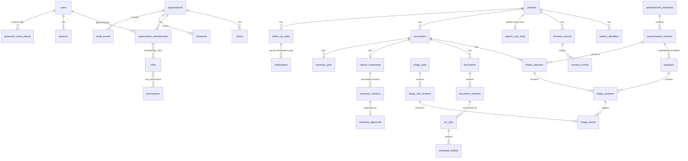

# Entity relationship overview

All tables use UUID primary keys and timezone-aware timestamps. Tenant-owned tables carry
`organization_id`; arrows below are composite `(organization_id, id)` foreign keys unless noted.

## Notable constraints

| Constraint | Purpose |
|---|---|
| `uq_intake_answers_current` (partial unique on `is_current`) | exactly one current revision per question |
| `ck_intake_answers_value_iff_answered` | value present only when `answer_status = answered`; unknown/declined/not-applicable are explicit states |
| `ck_triage_rule_versions_demo_never_clinical` | demo rules can never be enabled for clinical use |
| `ck_triage_rule_versions_approval_required` | clinical use requires a recorded approver |
| `uq_summary_approvals_summary_version_id` | one approval per immutable version (approval race backstop) |
| `uq_clinical_summaries_organization_id` + `encounter_id` | one summary lineage per encounter |
| `uq_ocr_jobs_…_idempotency_key`, `uq_summary_jobs_…` | idempotent job submission |
| `uq_notifications_idempotency_key` | duplicate-send prevention |
| `ck_patients_birth_date_or_age` | DOB or (age + as-of date) recorded with precision |

## Deletion semantics

No clinical table cascades deletes. Foreign keys to users/patients/encounters are `RESTRICT`.
Patients are deactivated, never deleted, until a reviewed retention policy exists
(see `docs/security/privacy-and-retention.md`). Only session/membership-role join rows cascade.
