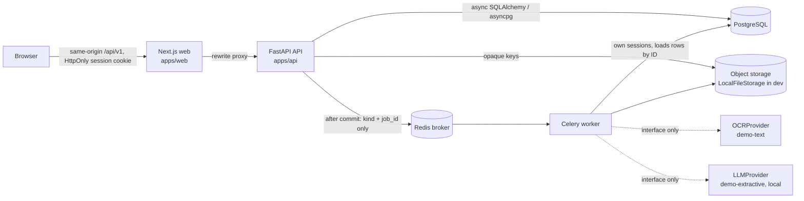

# Architecture overview

AyushCare AI is a **modular monolith**: one FastAPI service, one Celery worker process built
from the same code, one Next.js web app, PostgreSQL and Redis.

## Backend layout (`apps/api/app`)

| Path | Responsibility |
|---|---|
| `core/` | settings, structured logging with redaction, error envelope, Argon2id + token hashing, correlation IDs |
| `db/` | declarative base + naming conventions, async engine/session lifecycle, model registry |
| `modules/identity` | organizations, clinics, users, memberships, roles/permissions, sessions, invitations, access dependencies |
| `modules/audit` | append-only (by convention) audit events |
| `modules/patients` | registration, search, duplicates (flag-only), identifiers, consent records + events |
| `modules/encounters` | encounter lifecycle |
| `modules/intake` | versioned questionnaire engine, sessions, revisioned answers, demo Ayurveda template |
| `modules/triage` | deterministic versioned red-flag rules, events, transitions |
| `modules/documents` | upload validation, storage abstraction, authenticated download |
| `modules/ocr` | OCR jobs (idempotent, bounded), extraction, reviewer verification revisions |
| `modules/summaries` | source collection, structured output schema, citation validation, versions, approval |
| `modules/followups` | follow-up tasks, consent-aware idempotent reminders |
| `modules/dashboard` | overview, analytics with stated definitions, timeline, audit read, patient self-access |
| `modules/integrations` | FHIR R4 Patient export (unvalidated mapping) |
| `providers/` | OCR, LLM, translation/speech interfaces + demo implementations |
| `workers/` | dispatcher (inline recorder / Celery), Celery tasks |

Business rules live in `service.py` / pure modules (`definition.py`, `engine.py`,
`validation.py`); route handlers only translate HTTP ↔ service calls.

## Key data flows

1. **Intake** — staff start a session pinned to a *published* questionnaire version. Each
   answer write validates type, visibility (branching) and respondent role server-side, then
   appends a revision. Red-flag rules are evaluated deterministically in the same transaction.
2. **Documents/OCR** — upload is validated (extension ↔ magic bytes, size, PDF active content,
   image dimensions), stored under an opaque key, and released as `passed_validation_only`
   (no antivirus is configured). `POST /process` with `Idempotency-Key` persists an OCR job and
   enqueues it **after commit**. Extracted entities start `unverified`.
3. **Summaries** — the worker collects sources (current answers from submitted/reviewed
   sessions + *verified/corrected* OCR entities), calls the LLM provider with a timeout,
   validates the structured output (schema, every citation exists in this encounter/tenant at
   the exact revision, provenance consistency, language guard), re-checks that sources did not
   change, then stores an immutable version. Failures never produce placeholder output.
4. **Approval** — locks the summary row, requires the latest version, requires the current
   source snapshot hash to equal the version's, records approver membership + attestation.
   Any later edit creates a new draft needing its own approval.

## Database / session strategy

* Driver: asyncpg. Pool: `db_pool_size` (5) + `db_max_overflow` (5), `pool_timeout` 10 s,
  connect timeout 5 s, server-side `statement_timeout` 15 s, `pool_pre_ping`.
* One `AsyncSession` per request (`get_db`), explicit `commit()` in services, rollback on error.
* Workers use `session_scope()` per unit of work and dispose their engine at the end of each
  task's event loop.
* Schema is created only by Alembic (`alembic upgrade head`); the app never calls `create_all`.
  Alembic uses its own `NullPool` engine.
* Tenant integrity: every tenant-owned table has `organization_id`; children reference parents
  through composite `(organization_id, id)` foreign keys, so a row cannot point at another
  tenant's row even if a service bug passed the wrong ID (covered by a test).

## Job delivery trade-offs

Jobs are rows first (`ocr_jobs`, `summary_jobs`), so the table doubles as an outbox. Dispatch
happens after commit with only `(kind, job_id)`. If Redis is down the row remains `queued`;
the beat task `ayushcare.sweep` republishes stale queued OCR jobs. Celery is configured
`acks_late` + `reject_on_worker_lost`, so delivery is at-least-once; task bodies are
idempotent (row locks with `SKIP LOCKED`, terminal-state checks, bounded `max_attempts`).
Known gap: the sweeper does not yet cover summary jobs, and a summary job stuck in `running`
after a worker crash is not reclaimed automatically (OCR jobs are reclaimed after 10 min).
